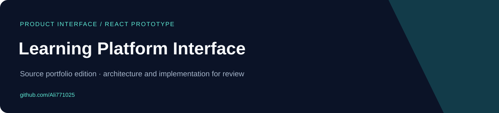
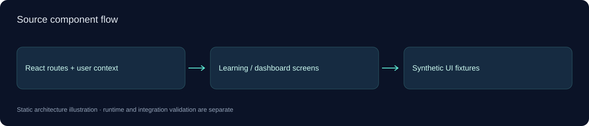

# Learning Platform Interface

<!-- project-contact:start -->
**Work with Yosof Omrani:** [Email a project inquiry](mailto:aliomrani916@gmail.com) · **aliomrani916@gmail.com** · [Services & contact](https://ali771025.github.io/software-portfolio/en/contact/) · [Portfolio walkthrough](https://ali771025.github.io/software-portfolio/en/#projects)
<!-- project-contact:end -->


**React/TypeScript interface prototype for learning dashboards, course views, placement flows, and a sample credentials-vault screen.**

[فارسی](docs/README.fa.md) · [Architecture](docs/ARCHITECTURE.md) · [Publication scope](docs/PUBLIC_EDITION.md)

## What the source contains

- Landing, dashboard, learning-center and course-view screens.
- Placement flow and user-context UI scaffolding.
- Synthetic mock content and animated React interface components.

## Start exploring

Node.js and npm compatible with the included package manifest and lockfile.

```bash
npm ci
npm run dev
```

These commands are a setup reference, not a record of successful execution. No builds, tests, hardware sessions, provider requests or application runs were performed for this publication.

## Code entry points

- [`src/App.tsx`](src/App.tsx)
- [`src/context/UserContext.tsx`](src/context/UserContext.tsx)
- [`src/pages/LearningCenter.tsx`](src/pages/LearningCenter.tsx)
- [`src/pages/CredentialsVault.tsx`](src/pages/CredentialsVault.tsx)

## Architecture



See the [architecture guide](docs/ARCHITECTURE.md) for module boundaries and integration assumptions. Diagrams represent source structure; they are not screenshots or deployment evidence.

## Scope and current limits

This is a frontend prototype, not a deployed learning service or a secure password-manager implementation. No real accounts, vault entries, environment keys, original service configuration or backend data are included. The vault is a screen concept and must not be used to store real secrets.

This compact public edition excludes previous Git history, real environment files, customer material, generated outputs and installed dependencies. Existing source/license notices are retained where present; no additional application license grant is invented.

## Work together

For a related workflow, custom application, integration or modernization project, [visit my GitHub profile](https://github.com/Ali771025) or [describe your project in an issue](https://github.com/Ali771025/learning-platform-interface/issues/new). Scope and deployment requirements can be discussed before implementation.
