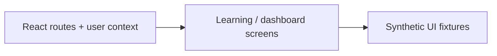

# Architecture — Learning Platform Interface

[Back to the project](../README.md)

## Responsibilities

- **React routes + user context:** Landing, dashboard, learning-center and course-view screens.
- **Learning / dashboard screens:** Placement flow and user-context UI scaffolding.
- **Synthetic UI fixtures:** Synthetic mock content and animated React interface components.

## Source boundaries

This is a frontend prototype, not a deployed learning service or a secure password-manager implementation. No real accounts, vault entries, environment keys, original service configuration or backend data are included. The vault is a screen concept and must not be used to store real secrets.

## Review entry points

- [`src/App.tsx`](../src/App.tsx)
- [`src/context/UserContext.tsx`](../src/context/UserContext.tsx)
- [`src/pages/LearningCenter.tsx`](../src/pages/LearningCenter.tsx)
- [`src/pages/CredentialsVault.tsx`](../src/pages/CredentialsVault.tsx)

## Verification boundary

This document is based on a static reading of the source. No new tests or builds were performed. Integration prerequisites, permission behavior, external dependencies and real data quality require their own acceptance work before production use.
